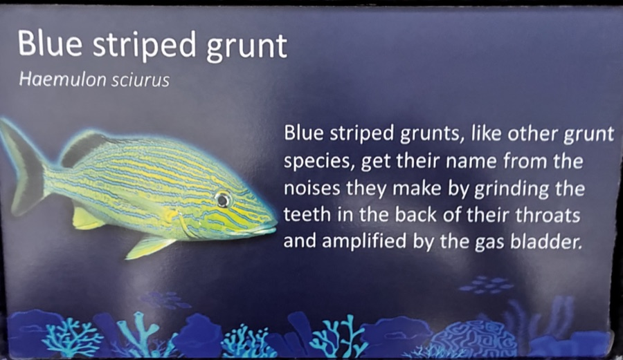

PhD, Computational Linguistics · Research Leader

Hello! I recently completed my PhD in Computer Science (Computational Linguistics) at Brandeis University, advised by Professor James Pustejovsky. My dissertation, *["Uh, Actually: Grunt Acts as Grounding Contributions in Multimodal Dialogue"](https://richardbrutti.github.io/files/Brutti_Dissertation.pdf)*, focuses on formal semantic and computational models for non-verbal communication, such as gesture and grunts, using naturalistic multimodal data. 

Learning what my last name means sent me down the linguistics path. I received my BA in Linguistics & Italian Studies from Boston College and MA in Computational Linguistics from Brandeis. 

I also serve as Director of Research at a large SaaS company, managing Machine Learning and Annotation teams focused on speech, audio, and NLP. Beyond my dissertation work, I have published on emotion recognition in speech, technology in education, and food and language.

<h2 class="section-label">Grunt Watch</h2>

Non-lexical vocalizations detected in recent podcast episodes. [More on the portfolio page](/portfolio/#grunt-watch).

<a href="https://www.instagram.com/grunt_watch/"><i class="fab fa-instagram" aria-hidden="true"></i> Instagram</a> · <a href="https://bsky.app/profile/gruntwatch.bsky.social"><i class="fab fa-bluesky" aria-hidden="true"></i> Bluesky</a>

<figure class="grunt">
  
  <figcaption>The blue striped grunt (<em>Haemulon sciurus</em>), from Ripley's Aquarium of Canada, Toronto.</figcaption>
</figure>
