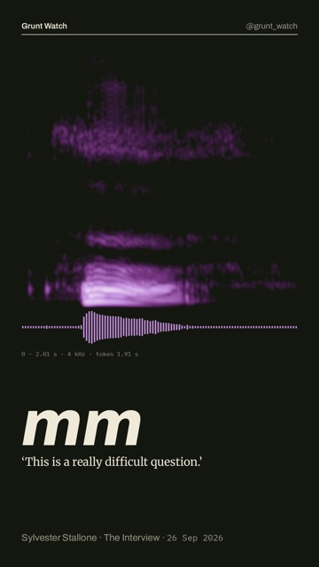
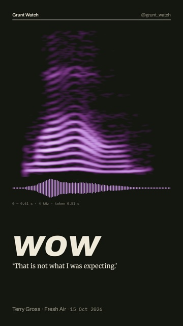

<section class="project" markdown="1">
<i class="fas fa-hands project__icon" aria-hidden="true"></i>

## Multimodal Semantics
My dissertation research developed formal semantic representations for non-verbal communication in dialogue. This includes **GAMR** (Gesture Abstract Meaning Representation), an extension of AMR for capturing gesture meaning, and work on **grunts** as complete communicative acts with distinct pragmatic functions.

**Key publications:** [Abstract meaning representation for gesture](/publication/2022-gamr), [The Grunt Work of Conversational Grounding: Minimal Responses in Multimodal Dialogue](/publication/2026-grunt-work)

**Dissertation:** [*"Uh, Actually: Grunt Acts as Grounding Contributions in Multimodal Dialogue"*](/files/Brutti_Dissertation.pdf)

For grunts out in the wild, see [Grunt Watch](#grunt-watch) below.
</section>

<section class="project project--grunt-watch" id="grunt-watch" markdown="1">
<i class="fas fa-wave-square project__icon" aria-hidden="true"></i>

## Grunt Watch
Non-lexical sounds (*mm*, *uh-oh*, *mm-hmm*) from recent podcast episodes. A wav2vec2-based model flags candidates; I listen, choose, spell, and gloss them. Transcripts are Whisper drafts, corrected by ear. Code writing assisted by Claude.

  
  

**Follow:** <a href="https://www.instagram.com/grunt_watch/"><i class="fab fa-instagram" aria-hidden="true"></i> Instagram</a> · <a href="https://bsky.app/profile/gruntwatch.bsky.social"><i class="fab fa-bluesky" aria-hidden="true"></i> Bluesky</a>
</section>

<section class="project" markdown="1">
<i class="fas fa-utensils project__icon" aria-hidden="true"></i>

## Culinary Linguistics
I apply computational methods to analyze food discourse, examining how language constructs authenticity and cultural identity. Projects include **R2VQ** (Recipe-to-Video Question Answering) and **Just Like My Nonna Made It:** Authority and Authenticity in Italian-American Tomato Sauce Recipes (forthcoming chapter on sociolinguistics and identity formation in Italian-American recipes).

**Resources:** [R2VQ](https://competitions.codalab.org/competitions/34056)
</section>

<section class="project" markdown="1">
<i class="fas fa-people-group project__icon" aria-hidden="true"></i>

## Collaborative Learning Technology
As a student researcher with **[iSAT](https://www.colorado.edu/research/ai-institute/)** (NSF Institute for Student-AI Teaming), I have worked on frameworks for understanding human collaboration in educational contexts. This includes work on common ground tracking and situated dialogue in collaborative problem-solving tasks.

I have also published on Digital Literacy in elementary CS education.
</section>
